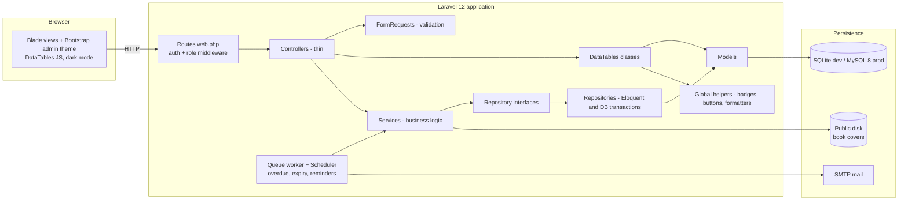
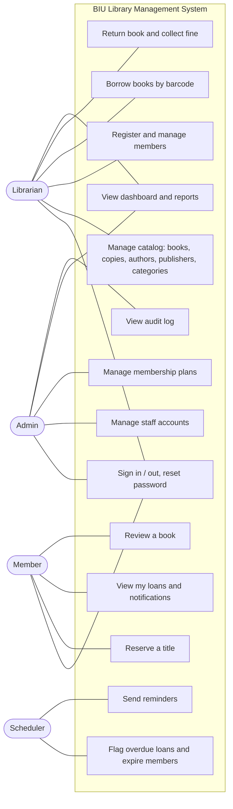
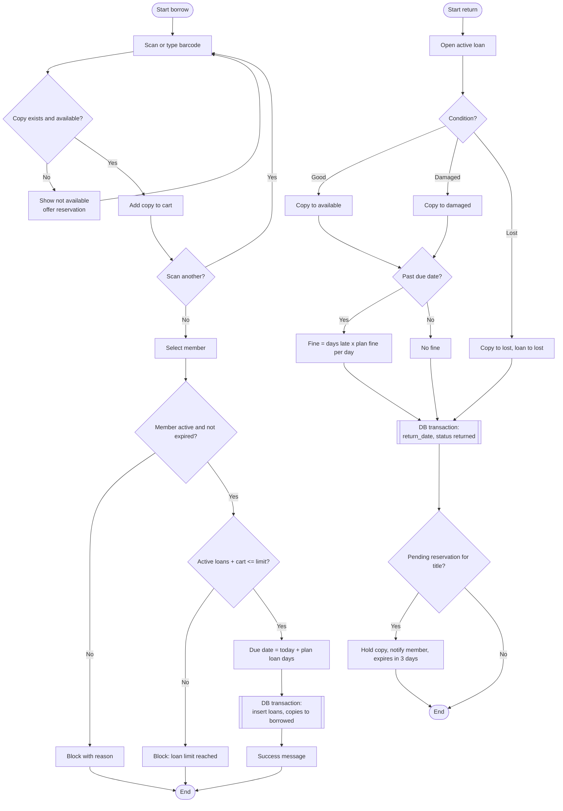
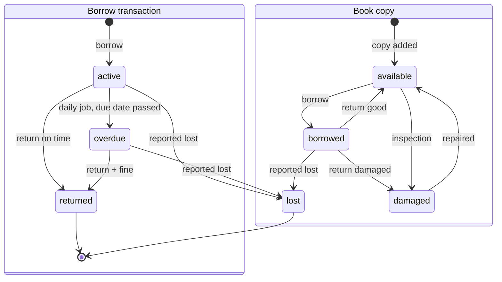
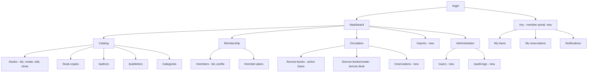

# BIU Library Management System — Design

| | |
|---|---|
| **Document** | SDLC Phase 3 — System & UI Design |
| **Version** | 1.0 — 2026-11-23 |
| **Requirements** | [01-requirements-and-planning.md](01-requirements-and-planning.md) |

## Design artifact index

| Artifact | Tool | Covers | Link |
|---|---|---|---|
| Entity Relationship Diagram | Lucidchart | All 15 tables, FKs, cardinality | [Open](https://lucid.app/lucidchart/d62c205d-e818-406f-b105-8ab35ae09055/edit) |
| Borrow & Return sequence | Lucidchart | FR-CIRC-01..07, target design incl. eligibility + atomic return | [Open](https://lucid.app/lucidchart/4f334118-3310-4abc-ac94-bcfc6058a40a/edit) |
| System architecture | Lucidchart | Layered pipeline, NFR-06 | [Open](https://lucid.app/lucidchart/67c88474-94a8-4ac5-ba91-de49b421283c/edit) |
| Use case diagram | Lucidchart | All roles × epics | [Open](https://lucid.app/lucidchart/0263f2ea-1fed-4412-8014-884d83b44b67/edit) |
| Circulation activity flow | Lucidchart | BR-01..BR-06 | [Open](https://lucid.app/lucidchart/7239b573-4d46-456c-a413-1610e0da90b2/edit) |
| Loan / copy state machines | Lucidchart | Status enums | [Open](https://lucid.app/lucidchart/3fcb3e8c-c863-4386-a02a-6b4d7919c9ab/edit) |
| Sitemap / navigation | Lucidchart | Screen inventory | [Open](https://lucid.app/lucidchart/671869a9-480d-4303-a1ae-9af806c6922c/edit) |
| Design tokens & component library | Figma | Color/space variables, 18 icons, Button, Status Badge, Form Input, Nav Item, KPI Tile | [Open](https://www.figma.com/design/VyTOFigM9ZabRdMk3uoJFQ) |
| UI screens (32) + style guide | SVG for Figma import | Every screen in the sitemap, plus modals, dark mode and 404 | [figma-svg/](figma-svg/) |
| UI wireframes (interactive) | HTML | Same 5 screens, light/dark toggle | [wireframes.html](wireframes.html) |

The Mermaid sources below are the canonical text versions (rendered by GitHub and VS Code); the Lucidchart
documents were imported from them.

## 1. System Architecture

## 2. Use Cases

Admin inherits every librarian use case.

## 3. Circulation Activity Flow

## 4. State Machines

## 5. Sitemap / Navigation

## 6. UI Design System (Figma)

Based on the existing Kaiadmin-style Bootstrap theme in `public/assets/`:

| Token | Light | Dark | Use |
|---|---|---|---|
| `primary` | `#1572E8` | `#1572E8` | Primary buttons, links, active nav |
| `secondary` | `#6861CE` | `#6861CE` | Secondary actions |
| `success` | `#31CE36` | `#31CE36` | `available`, `returned`, `active` badges |
| `danger` | `#F25961` | `#F25961` | `overdue`, `lost`, delete |
| `warning` | `#FFAD46` | `#FFAD46` | `borrowed`, `pending`, `damaged` |
| `sidebar` | `#1A2035` | `#1A2035` | Sidebar background |
| `surface` | `#FFFFFF` | `#202940` | Cards |
| `background` | `#F5F7FD` | `#1A2035` | Page |
| Font | Public Sans (fallback Inter) | | 14 px body, 600 headings |

Figma file **BIU LMS — UI Design** holds the variables (`BIU Color`, `BIU Space`), icon set and components. The dark
theme is documented as reference values because variable modes need a paid Figma plan.

### Screen mockups for Figma (SVG)

All 32 screens and a style guide are in [figma-svg/](figma-svg/) as plain 1440 × 900 SVGs (the style guide is
1440 × 1000). They use the same tokens, with named layers (`Sidebar`, `Top Navbar`, `KPI/…`, `Button/…`, `Badge/…`,
`Field/…`, `Row 1…`) and real text, so they import as editable layers.

| File | Screen | Requirements |
|---|---|---|
| [00-style-guide.svg](figma-svg/00-style-guide.svg) | Colors (light + dark), type ramp, icons, buttons, badges, inputs, tabs, checkbox, radio, rating, chips, KPI tiles | NFR-04 |
| **Auth** | | |
| [01-login.svg](figma-svg/01-login.svg) | Login with error state | FR-AUTH-01 |
| [06-forgot-password.svg](figma-svg/06-forgot-password.svg) | Reset-password request, sent confirmation | FR-AUTH-04 |
| **Dashboard** | | |
| [02-dashboard.svg](figma-svg/02-dashboard.svg) | Staff dashboard: KPIs, loans chart, top titles, overdue table | FR-DASH-01, 02 |
| [31-dashboard-dark.svg](figma-svg/31-dashboard-dark.svg) | Same dashboard in the dark theme | NFR-04 |
| **Catalog** | | |
| [03-books-list.svg](figma-svg/03-books-list.svg) | Books DataTable with copy badges, CSV import | FR-CAT-01, 04, 06 |
| [07-book-form.svg](figma-svg/07-book-form.svg) | Add book: validation error, author multi-select, cover upload, initial copies | FR-CAT-01, 03 |
| [08-book-detail.svg](figma-svg/08-book-detail.svg) | Book detail: copy counts by status, current borrowers, reviews with moderation | FR-CAT-05, FR-REV-02 |
| [09-book-copies.svg](figma-svg/09-book-copies.svg) | Copies DataTable with status filter, print labels | FR-CAT-03, 07 |
| [10-book-copy-form.svg](figma-svg/10-book-copy-form.svg) | Add copy with auto barcode | FR-CAT-03 |
| [11-authors.svg](figma-svg/11-authors.svg) · [12-author-form.svg](figma-svg/12-author-form.svg) | Authors list and edit form | FR-CAT-02 |
| [13-publishers.svg](figma-svg/13-publishers.svg) · [14-publisher-form.svg](figma-svg/14-publisher-form.svg) | Publishers list and add form | FR-CAT-02 |
| [15-categories.svg](figma-svg/15-categories.svg) · [16-category-form.svg](figma-svg/16-category-form.svg) | Categories list and add form with unique slug | FR-CAT-02 |
| **Membership** | | |
| [17-members.svg](figma-svg/17-members.svg) | Members DataTable with plan and status filters | FR-MEM-01 |
| [18-member-form.svg](figma-svg/18-member-form.svg) | Add member, plan summary, portal login option | FR-MEM-01, 05 |
| [19-member-profile.svg](figma-svg/19-member-profile.svg) | Profile: active loans, history, outstanding fines | FR-MEM-04, FR-CIRC-07 |
| [20-member-plans.svg](figma-svg/20-member-plans.svg) · [21-member-plan-form.svg](figma-svg/21-member-plan-form.svg) | Plan cards and edit form | FR-MEM-02 |
| **Circulation** | | |
| [04-borrow-desk.svg](figma-svg/04-borrow-desk.svg) | Borrow desk: barcode scan, cart, member eligibility, auto due date | FR-CIRC-01..04 |
| [22-borrow-list.svg](figma-svg/22-borrow-list.svg) | Loans DataTable with status tabs | FR-CIRC-05, 06 |
| [23-return-modal.svg](figma-svg/23-return-modal.svg) | Return dialog: condition, fine calculation, reservation hold | FR-CIRC-05, 07, 08, FR-RES-02 |
| [24-reservations.svg](figma-svg/24-reservations.svg) | Reservations with queue, hold expiry, fulfil/cancel | FR-RES-01..03 |
| **Administration** | | |
| [25-reports.svg](figma-svg/25-reports.svg) | Reports: circulation chart, inventory by status, category table, CSV/PDF export | FR-DASH-03 |
| [26-users.svg](figma-svg/26-users.svg) · [27-user-form.svg](figma-svg/27-user-form.svg) | Staff accounts, roles, deactivate, permission matrix | FR-AUTH-02, 05, 06 |
| [28-audit-log.svg](figma-svg/28-audit-log.svg) | Audit log with filters, field diff and raw JSON | FR-AUD-01, 02 |
| **Member portal** | | |
| [05-member-portal.svg](figma-svg/05-member-portal.svg) | Member home: loans, fines, notifications | FR-DASH-04, FR-NOTI-03 |
| [29-member-catalog.svg](figma-svg/29-member-catalog.svg) | Catalog search with category chips and reserve buttons | FR-RES-01 |
| [30-review-modal.svg](figma-svg/30-review-modal.svg) | Write-a-review dialog with star rating | FR-REV-01 |
| **System** | | |
| [32-not-found.svg](figma-svg/32-not-found.svg) | 404 page | — |

**Import into Figma:** drag the `.svg` files onto the canvas (or File → Place image). Each becomes a frame of editable
vectors and text. Text uses **Public Sans** (and **Roboto Mono** for the audit log's JSON block), both of which Figma
provides from Google Fonts. Modal screens (23, 30) contain the page underneath plus an `Overlay` layer, so the dialog
can be copied out on its own. To change a screen, edit
`figma-svg/generate.py` and run `python figma-svg/generate.py figma-svg` from `docs/sdlc/`.

## 7. Key Design Decisions

| # | Decision | Rationale |
|---|---|---|
| D1 | Keep Repository + Service layering for new epics | Consistency, testability (mock interfaces) |
| D2 | Eligibility checks live in `BorrowService`, not FormRequest | Needs DB state (loan count, plan), reused by member self-borrow |
| D3 | Scheduled commands for overdue / expiry / reminders | Avoid computing status on every read; dashboard queries stay cheap |
| D4 | Store `fine_amount` on the transaction at return | Historical accuracy if plan fines change later |
| D5 | Audit via model observer trait | One place; no controller changes |
| D6 | Add `members.user_id` (nullable FK) for member login | Members and staff share `users` auth with `role` |
